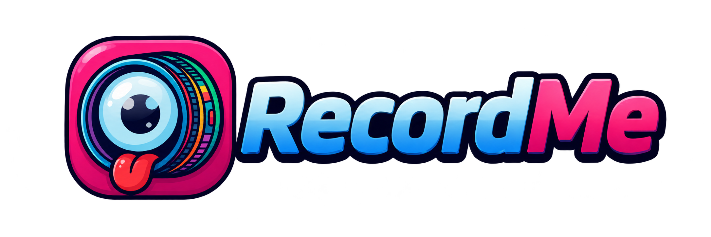

<div align="center">



# RecordMe

**The next-generation, distraction-free screen recorder built for content creators, educators, presenters, and software engineers.**

<a href="https://github.com/jhordy2004/RecordMe/actions/workflows/build.yml"></a>
<a href="https://www.python.org/downloads/"></a>
<a href="LICENSE"></a>
<a href="#cross-platform-architecture"></a>

</div>

---

## Overview

**RecordMe** is a high-performance desktop screen recorder crafted to make presentation recording effortless, elegant, and private. Inspired by the simplicity and ergonomics of modern snipping tools, RecordMe integrates a full presenter studio into a lightweight floating toolbar.

With RecordMe, your toolbars, widgets, and prompters remain completely invisible in the final video output through hardware-level window exclusion.

---

## Key Features

- **Full Screen & Custom Region Selection**: Record your entire desktop across multiple DPI-scaled monitors or drag an exact capture bounding box with pixel-perfect alignment.
- **Floating Camera (Picture-in-Picture)**:
  - Supports circular avatar or rounded-rectangular video frames.
  - Real-time AI background removal and selfie segmentation powered by ONNX.
  - Chroma keying (green/blue screen) support with customizable tolerance and thresholding.
  - Click-and-drag repositioning anywhere on the screen during live recording.
- **Invisible Teleprompter**:
  - Semi-transparent, auto-scrolling script teleprompter with acrylic blur-behind effect.
  - Configurable Words Per Minute (WPM), font sizing, line spacing, and margin padding.
  - Reads text files (`.txt`, `.docx`, markdown) directly.
  - **Exclusion guarantee**: Invisible to the final recorded video.
- **Real-Time Dynamic Zoom**:
  - Focus in on code, UI elements, or documents with smooth animated zoom transitions (1.5x, 2.0x, 3.0x).
  - Follow the mouse cursor dynamically or anchor to regions of interest.
- **Live Privacy & Censor Boxes**:
  - Blur, pixelate, or mask sensitive passwords, API keys, and personal credentials in real time before encoding.
- **Smart Global Hotkeys with Input Protection**:
  - Global hotkeys (`Alt+R` to record/stop, `Alt+P` to pause/resume, `Alt+L` to select area, `Alt+M` for mic mute, `Alt+C` for camera, `Alt+T` for teleprompter, `Alt+X` for censorship, `Alt+Q` to exit).
  - **Zero Input Collisions**: All action shortcuts strictly use `Alt+<Key>`, preventing any accidental triggers when typing in browser search bars, terminals, Word, or messaging apps. Standard system and application shortcuts like copy (`Ctrl+C`), cut (`Ctrl+X`), and browser new tab (`Ctrl+T`) are fully preserved and collision-free.
- **Clean Subprocess & Headless Output**:
  - Silent video rendering and muxing pipeline powered by bundled FFmpeg without terminal windows or command prompts popping up.
- **100% Offline & Private**:
  - Zero telemetry, no cloud dependencies, no analytics. All recordings stay on your local disk.

---

## Cross-Platform Architecture

| Feature | Windows 10 / 11 | macOS (13+) | Linux (X11 / Wayland) |
| :--- | :--- | :--- | :--- |
| **Capture Engine** | DXGI Desktop Duplication (`dxcam`) | ScreenCaptureKit (`SCStream`) | X11 Shared Memory / XFixes |
| **Window Exclusion** | `WDA_EXCLUDEFROMCAPTURE` (DWM) | `SCContentFilter(excludingWindows:)` | Auto-repositioning outside region |
| **Background Blur** | Windows Acrylic / Mica API | `NSVisualEffectView` | Modern Qt translucency |
| **Distribution** | `.exe` (OneFile), Inno Setup installer, `.zip` | Native `.app` bundle, `.dmg` image | Portable `.AppImage` |

---

## Installation & Setup

### Option 1: Standalone Installers (Pre-compiled Releases)

Download the latest pre-compiled binaries from the [Releases](https://github.com/jhordy2004/RecordMe/releases) page:

- **Windows**: Download `RecordMe_Setup_v0.1.0.exe` (wizard installer) or `RecordMe.exe` (portable single-file executable).
- **macOS**: Download `RecordMe-0.1.0-macOS.dmg` and drag RecordMe into your `Applications` folder.
- **Linux**: Download `RecordMe-0.1.0-x86_64.AppImage`, make it executable (`chmod +x RecordMe-*.AppImage`), and run it.

---

### Option 2: Running from Source (Developer Setup)

#### 1. Clone the Repository

```bash
git clone https://github.com/jhordy2004/RecordMe.git
cd RecordMe
```

#### 2. Create and Activate a Virtual Environment

**Windows (PowerShell):**
```powershell
python -m venv .venv
.\.venv\Scripts\Activate.ps1
```

**macOS / Linux (Bash):**
```bash
python3 -m venv .venv
source .venv/bin/activate
```

#### 3. Install Dependencies

Install the project along with development tools:

```bash
pip install --upgrade pip
pip install -e ".[dev]"
```

*Note: FFmpeg is automatically discovered and supplied via `imageio-ffmpeg` or detected from your system PATH.*

#### 4. Run the Application

```bash
python -m recordme
```

---

## Development & Testing

Run the full automated test suite (unit and integration tests):

```bash
pytest tests/ -v
```

Run code formatting and lint verification:

```bash
ruff check src/
```

### Packaging Locally

- **Windows**:
  ```powershell
  .\build_release.ps1
  ```
- **macOS**:
  ```bash
  ./scripts/package_macos.sh
  ```
- **Linux**:
  ```bash
  ./scripts/package_linux.sh
  ```

---

## Shortcuts Reference

| Shortcut | Action |
| :---: | :--- |
| `Alt+R` | Start / Stop Recording |
| `Alt+P` | Pause / Resume Recording |
| `Alt+L` | Select Custom Capture Area |
| `Esc` | Cancel Selection / Reset to Fullscreen |
| `Alt+M` | Toggle Microphone Mute |
| `Alt+C` | Toggle Webcam Overlay |
| `Alt+T` | Toggle Teleprompter |
| `Alt+X` | Add Censor / Blur Box |
| `Alt +, Alt -` | Dynamic Zoom In / Out |
| `Alt+0` | Reset Zoom to 100% |
| `Alt+Arrows` | Pan Zoomed View (or Arrow keys when zoomed) |
| `Alt+Q` | Quit RecordMe |

---

## Contributing

Contributions, bug reports, and pull requests are warmly welcomed! Please feel free to open an issue or submit a pull request on GitHub.

1. Fork the Project.
2. Create your Feature Branch (`git checkout -b feature/NewFeature`).
3. Commit your Changes (`git commit -m 'Add NewFeature'`).
4. Push to the Branch (`git push origin feature/NewFeature`).
5. Open a Pull Request.

---

## License

RecordMe is licensed under the [GNU Affero General Public License v3.0](LICENSE).

---

## Author's Words

Hello, this project was actually born because I had problems with the Windows Snipping Tool. I was using it, but it wasn't recording the first 10 seconds of the recording. I got a little upset, and the best idea I could come up with was to create RecordMe.

I hope you like it and that this program can help more than one person.
